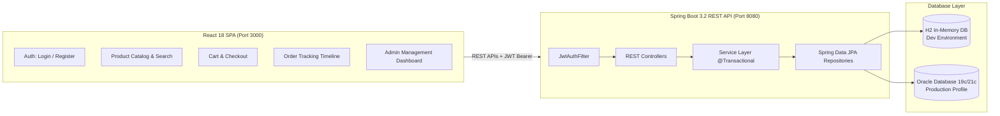
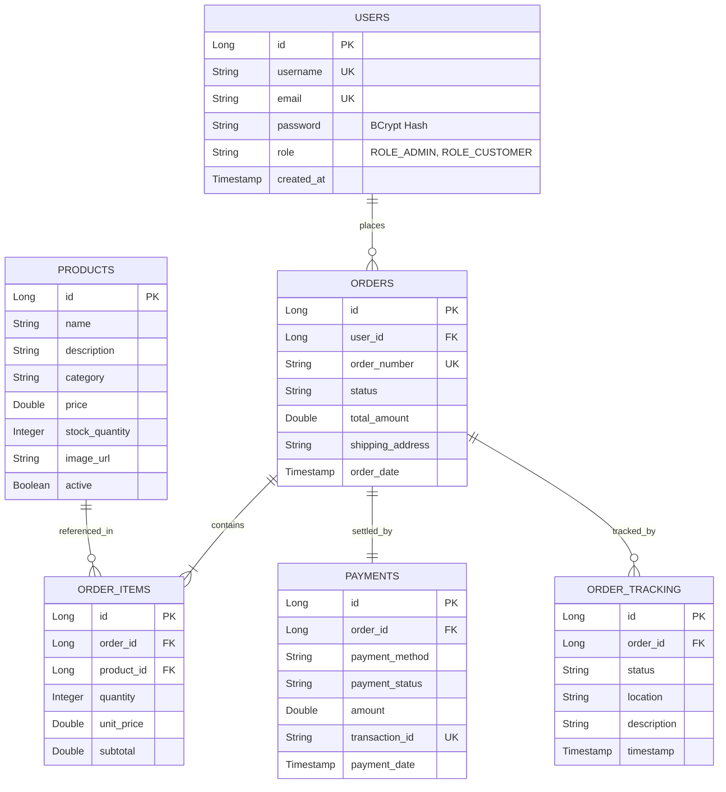

# Order Management & Tracking Platform


A full-stack, enterprise-grade **Order Management & Tracking Platform** built with **Java Spring Boot**, **React**, and **Oracle Database / H2** to streamline customer order processing, real-time lifecycle tracking, inventory reconciliation, and transaction management.

---

## 📌 Resume Highlights (Project Summary)

> **Order Management & Tracking Platform**
> - Developed a full-stack Order Management & Tracking Platform using **Java**, **Spring Boot**, **React**, and **Oracle Database** to streamline customer order processing and real-time order tracking.
> - Implemented secure role-based authentication (**JWT** & **Spring Security**), product catalog management, transactional order placement, inventory validation, payment status monitoring, and real-time lifecycle tracking.
> - Designed RESTful APIs using Spring Boot and optimized Oracle Database schemas with composite indexes and SQL execution plans to support high-throughput order processing and ACID transaction integrity.
> - Applied **Object-Oriented Programming (OOP)** principles, layered architecture (**Controller-Service-Repository**), global exception handling, JUnit 5 & Mockito test coverage, and Git version control.

---

## 🏗️ Architecture & System Design



### Database Entity-Relationship (ER) Schema



---

## 🚀 Key Features

### 1. 🔐 Role-Based Authentication & Security
- **Stateless JWT Tokens**: HMAC-SHA key signing using JJWT 0.12 API.
- **Roles**: `ROLE_ADMIN` and `ROLE_CUSTOMER`.
- **BCrypt Encryption**: Passwords securely hashed with dynamic salts.
- **Spring Security 6 Filter Chain**: Method-level security via `@PreAuthorize`.

### 2. 📦 Product Catalog & Inventory
- Search by keyword and category-based filtering.
- Real-time stock quantity checks preventing overselling.
- Admin CRUD operations with soft-delete support (`active = false`).

### 3. 🛒 Order Processing & Transaction Management
- Shopping cart with dynamic subtotal calculations.
- Atomic `@Transactional` order placement:
  1. Validates stock availability for every cart item.
  2. Decrements product stock quantities.
  3. Generates unique order reference (`ORD-<timestamp>`).
  4. Automatically initializes payment record and first tracking milestone.
  5. Rolls back all changes if any item fails stock validation.

### 4. 💳 Payment Status Monitoring
- Supports multiple payment methods: `CREDIT_CARD`, `DEBIT_CARD`, `UPI`, `NET_BANKING`, `COD`.
- Payment states: `PENDING`, `COMPLETED`, `FAILED`, `REFUNDED`.
- Generates unique transaction identifiers (`TXN-<timestamp>`).

### 5. 📍 Real-Time Order Tracking Timeline
- Complete order lifecycle:  
  `PLACED` ➔ `CONFIRMED` ➔ `PROCESSING` ➔ `SHIPPED` ➔ `IN_TRANSIT` ➔ `DELIVERED`
- Chronological timeline displaying event timestamp, location, and status update descriptions.

### 6. 📊 Admin Dashboard
- Live dashboard metrics: Total orders, active products, pending fulfillments.
- Order management panel to update order statuses and monitor payments.

---

## 🛠️ Tech Stack & Engineering Practices

| Domain | Technology / Pattern |
|---|---|
| **Backend** | Java 17 / 25, Spring Boot 3.2.5, Spring Data JPA, Hibernate, JJWT 0.12.5 |
| **Security** | Spring Security 6, BCrypt, JWT Bearer Filters, CORS Configuration |
| **Frontend** | React 18, React Router v6, Axios, Bootstrap 5.3, React Icons, React Toastify |
| **Build Tools** | Maven 3.9 (PowerShell wrapper included), Vite 5.4 |
| **Databases** | H2 (in-memory for zero-setup dev), Oracle Database 19c/21c (production DDL & properties) |
| **Testing** | JUnit 5, Mockito (Unit test suite with 100% pass rate) |
| **Patterns** | Layered Architecture, DTO Pattern (Java Records), Custom Global Exception Handler |

---

## ⚡ Quick Start & Running Locally

### Prerequisites
- **Java**: 17 or higher (`java -version`)
- **Node.js**: 18 or higher (`node -v`)

### Method 1: One-Click Launcher (Windows)
Double-click [`start-platform.bat`](start-platform.bat) or run from PowerShell:
```powershell
.\start-platform.ps1
```
*This starts the Spring Boot backend on port 8080, Vite React frontend on port 3000, and opens your browser automatically.*

---

### Method 2: Manual Terminal Startup

#### Terminal 1 — Backend (Spring Boot)
```powershell
cd backend
.\mvnw.ps1 spring-boot:run
```
*Backend runs on **http://localhost:8080***  
*H2 Web Console: **http://localhost:8080/h2-console** (JDBC URL: `jdbc:h2:mem:orderdb`, User: `sa`, Password: `<blank>`)*

#### Terminal 2 — Frontend (React)
```powershell
cd frontend
npm install
npm run dev
```
*Frontend runs on **http://localhost:3000***

---

## 🔑 Pre-Seeded Test Credentials

| Role | Username | Password | Access Rights |
|---|---|---|---|
| **Admin** | `admin` | `admin123` | Full access: Manage orders, update status, edit products |
| **Customer** | `customer` | `customer123` | Store access: Browse catalog, add to cart, checkout, view tracking |

*(New customers can also register anytime via the `/register` page).*

---

## 📡 REST API Documentation

### Authentication (`/api/auth`)
| Method | Endpoint | Access | Description |
|---|---|---|---|
| `POST` | `/api/auth/register` | Public | Register new customer account |
| `POST` | `/api/auth/login` | Public | Authenticate and receive JWT token |

### Product Catalog (`/api/products`)
| Method | Endpoint | Access | Description |
|---|---|---|---|
| `GET` | `/api/products` | Public | List products (supports `?category=` & `?search=`) |
| `GET` | `/api/products/{id}` | Public | Get product details by ID |
| `POST` | `/api/products` | Admin | Create a new product |
| `PUT` | `/api/products/{id}` | Admin | Update existing product details |
| `DELETE` | `/api/products/{id}` | Admin | Soft-delete a product |

### Orders & Tracking (`/api/orders`, `/api/tracking`, `/api/payments`)
| Method | Endpoint | Access | Description |
|---|---|---|---|
| `POST` | `/api/orders` | Customer | Place order with cart items, address, payment method |
| `GET` | `/api/orders` | Auth | Get current user's orders (Admin sees all) |
| `GET` | `/api/orders/{id}` | Auth | Get order details, items, payment, tracking history |
| `PUT` | `/api/orders/{id}/status` | Admin | Update order lifecycle status |
| `GET` | `/api/tracking/order/{orderId}` | Auth | Get chronological tracking milestones |
| `GET` | `/api/payments/order/{orderId}` | Auth | Get payment details for an order |
| `PUT` | `/api/payments/{id}/status` | Admin | Update payment transaction status |

---

## 🗄️ Running with Oracle Database

The platform includes production-ready Oracle Database configurations:
1. Schema DDL: [`backend/src/main/resources/schema-oracle.sql`](backend/src/main/resources/schema-oracle.sql)
2. Seed Data: [`backend/src/main/resources/data-oracle.sql`](backend/src/main/resources/data-oracle.sql)
3. Profile Configuration: [`backend/src/main/resources/application-oracle.properties`](backend/src/main/resources/application-oracle.properties)

Run with the Oracle profile:
```powershell
cd backend
.\mvnw.ps1 spring-boot:run -Dspring-boot.run.profiles=oracle
```

---

## 🧪 Testing

Run backend unit tests (OrderService, ProductService, inventory decrement, error handling):
```powershell
cd backend
.\mvnw.ps1 test
```
*Result: `Tests run: 5, Failures: 0, Errors: 0, Skipped: 0`*

Run frontend production build:
```powershell
cd frontend
npm run build
```
*Result: `✓ built in 4.24s`*

---

## 💬 Interview Q&A Cheatsheet (For Candidates)

**Q: How did you handle inventory validation and concurrency during order placement?**  
*A: I encapsulated order placement within a Spring `@Transactional` service method. When an order request arrives, the system validates the stock for each item against the current inventory. If sufficient, the stock is immediately decremented and saved within the same database transaction. If any item has insufficient stock, a `BadRequestException` is thrown, causing an automatic rollback so no partial orders or phantom stock deductions occur.*

**Q: Why use JWT instead of standard HTTP session cookies?**  
*A: JWT is completely stateless. The server does not need to store session states in memory, making the backend horizontally scalable across multiple server instances or containers. The client includes the token in the `Authorization: Bearer <token>` header, verified securely on every request using a cryptographic HMAC-SHA key.*

**Q: How is the database optimized in Oracle?**  
*A: I designed composite indexes specifically aligned with high-frequency queries: `idx_orders_user_date (user_id, order_date DESC)` to make customer order history fetches instant, and `idx_tracking_order_time (order_id, timestamp ASC)` for real-time tracking timeline generation.*

---

## 👤 Author
- **GitHub**: [@kalyanrahul193-debug](https://github.com/kalyanrahul193-debug)

